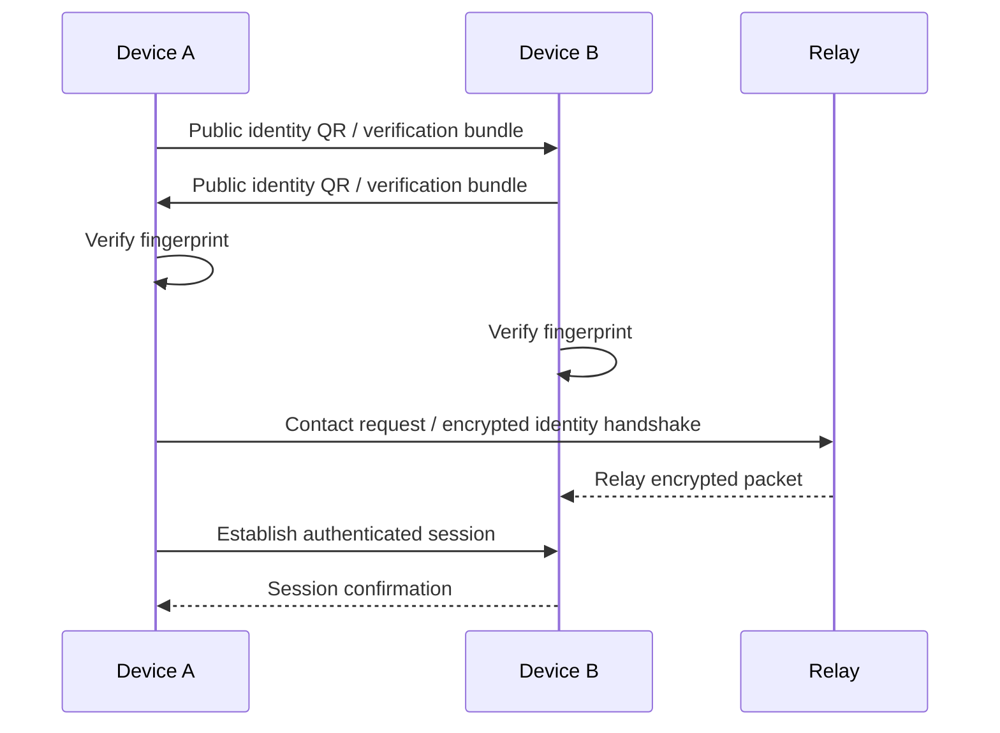
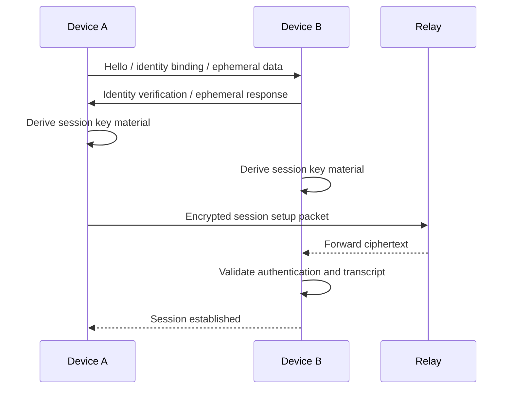
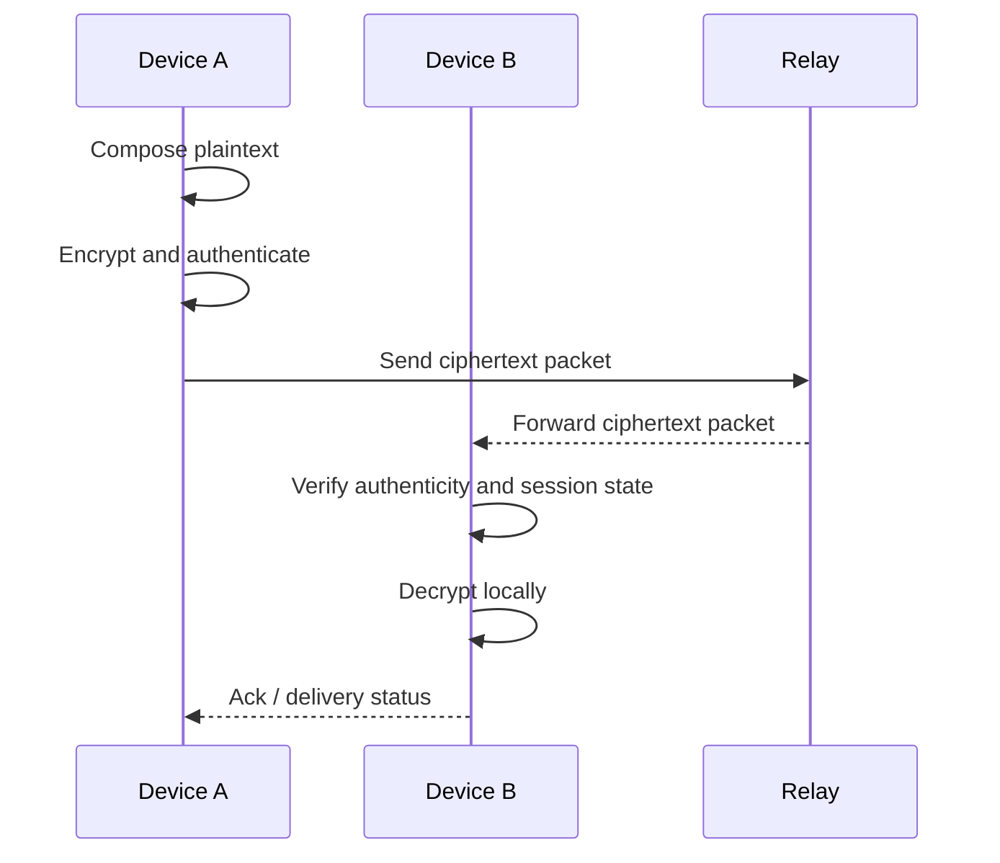
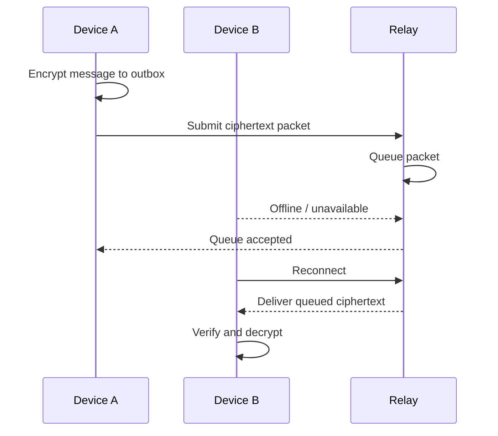
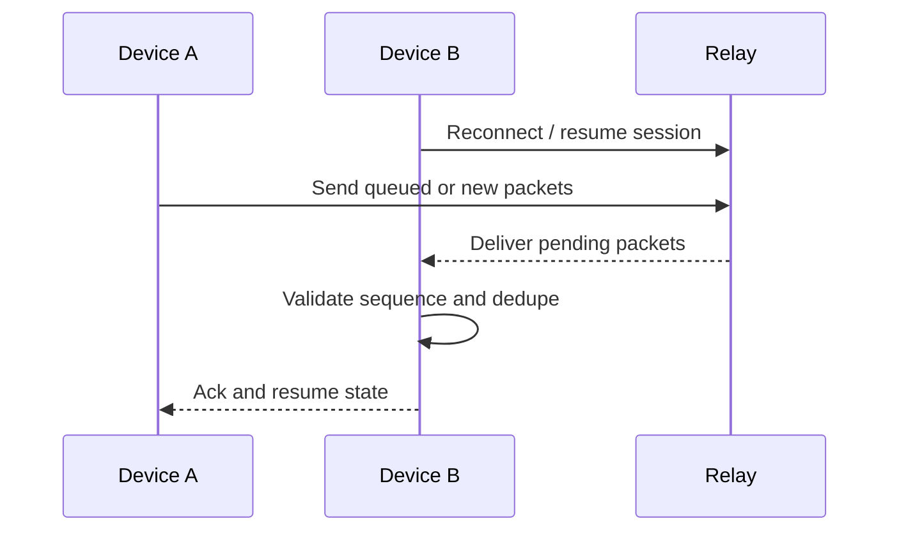
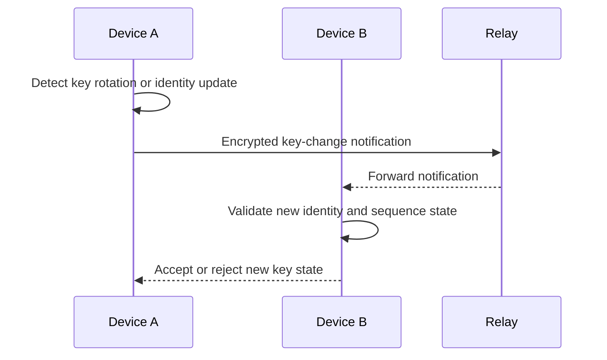
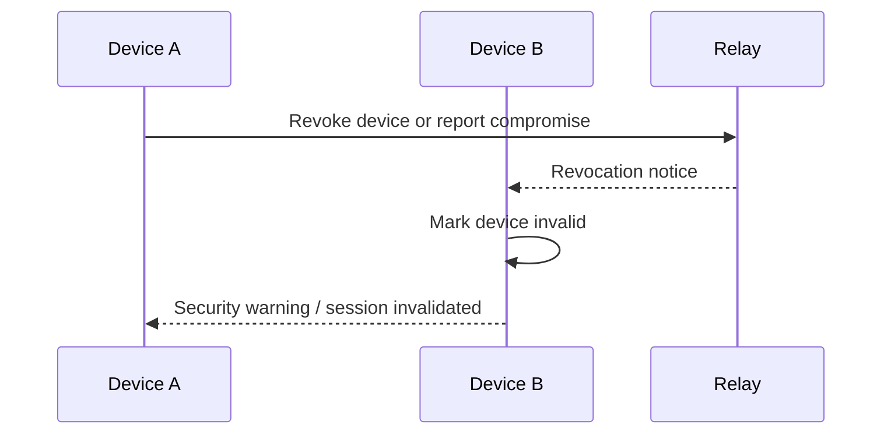
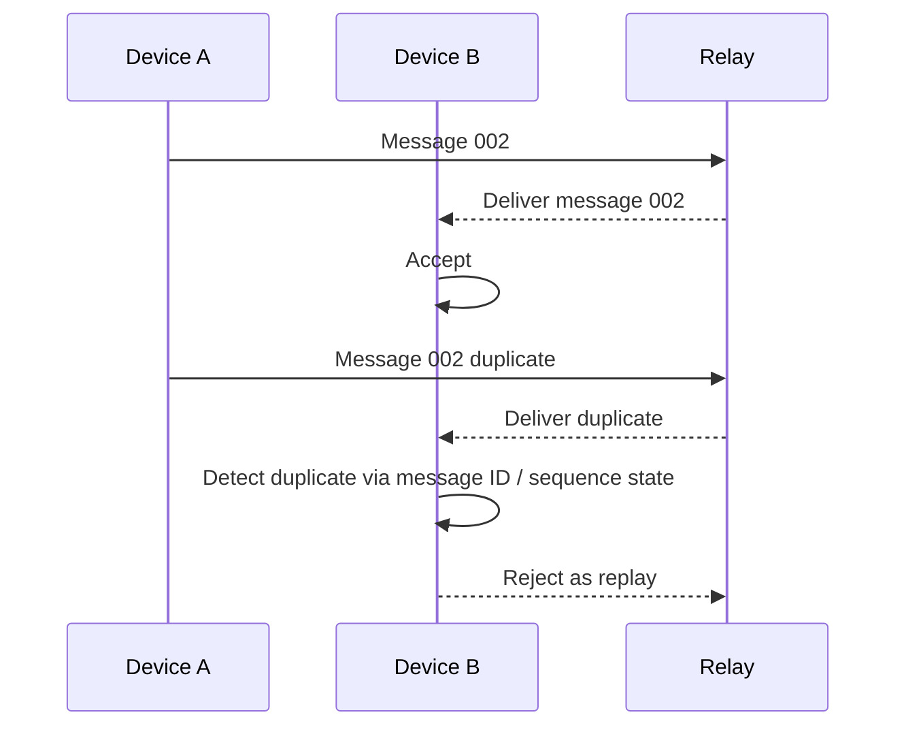
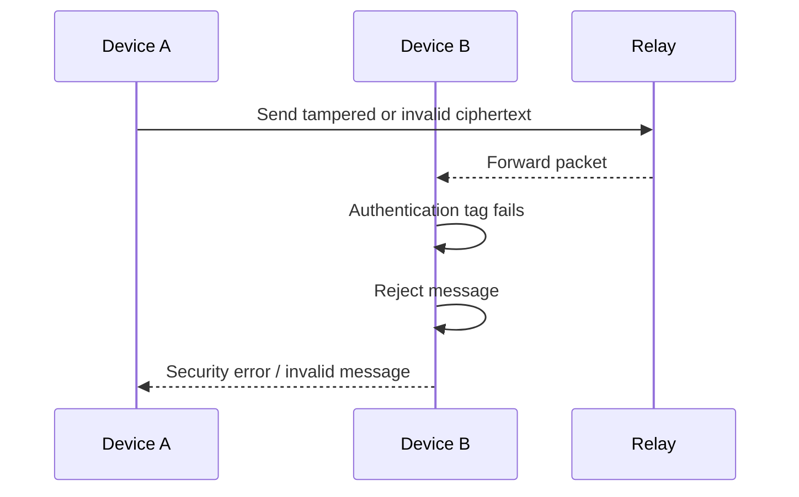

# Message flow and sequence diagrams

## High-level flow

```text
Person A
  ↓ compose plaintext
  ↓ local encryption
  ↓ authenticated encrypted message
  ↓ ciphertext packet
  ↓ relay
  ↓ ciphertext packet
  ↓ Person B device
  ↓ verification
  ↓ decryption
  ↓ plaintext displayed locally
```

## Sequence diagram: first contact



## Sequence diagram: session establishment



## Sequence diagram: normal message



## Sequence diagram: offline recipient



## Sequence diagram: reconnect



## Sequence diagram: key change



## Sequence diagram: device revocation



## Sequence diagram: replayed message



## Sequence diagram: invalid message



## Message handling rules

- The receiver must validate message authentication before decryption.
- The receiver must reject duplicates and old replays.
- The receiver must not display plaintext for unauthenticated or invalid payloads.
- Out-of-order handling must be explicit and safe.
