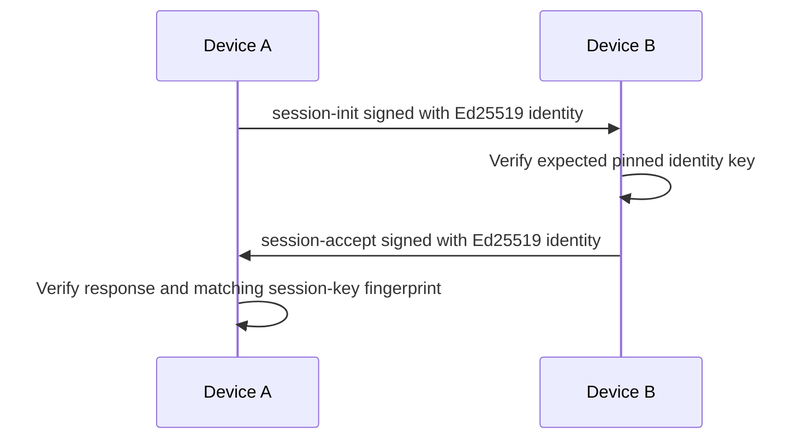
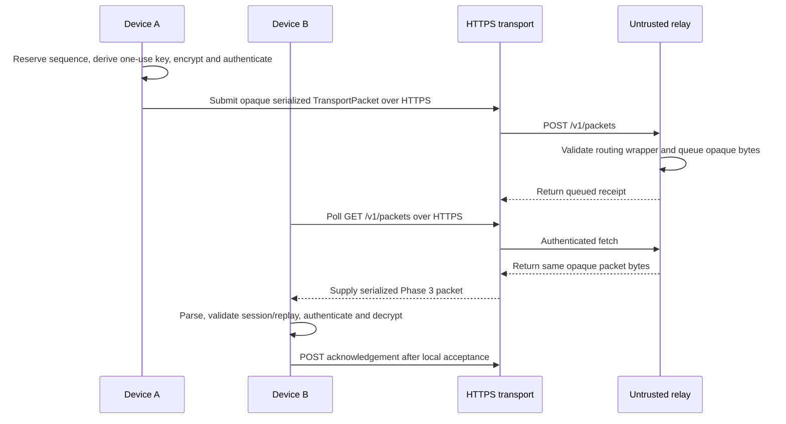
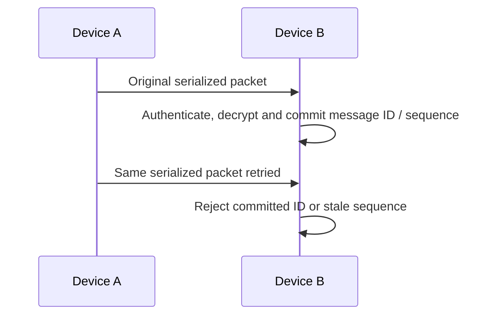

# Message flow

## Implemented local message lifecycle

```text
Device A
  -> MessageService.sendEncryptedMessage
  -> SessionService reserves sequence and lends a one-use message key
  -> AES-256-GCM encrypts UTF-8 plaintext with canonical header AAD
  -> versioned envelope and separate transport metadata
  -> EncryptedMessageStore persists local plaintext and exact serialized packet
  -> outbox submits exact serialized bytes to HTTPS transport
  -> untrusted relay queues and forwards bytes without parsing the Phase 3 envelope
  -> Device B parses and validates canonical envelope
  -> session validates peer direction and replay state
  -> AES-256-GCM authenticates and decrypts
  -> authenticated plaintext is persisted locally before replay state commits
  -> Device B acknowledges the relay only after local persistence succeeds
```

The packages implement the message protocol, HTTPS/in-memory relay, encrypted file-backed message store, and a UI-independent messaging coordinator. The relay queue is still in memory; the local store needs a host-provided platform-secure key. No chat UI, WebSocket, background sync, or production deployment exists.

## Existing identity and session foundation



## Local transport exchange



## Replay and retry behavior



The receiver holds a session lock across replay validation, key derivation, AEAD authentication/decryption, the authenticated persistence callback, and replay-state commit. Failed authentication or local persistence does not consume the message ID or sequence. Sequences must increase; gaps are permitted and out-of-order delivery is not. A retry resends the exact packet with the same message ID. Re-encrypting creates a new message ID, sequence, key, and nonce.

Relay acceptance marks an outgoing item submitted and removes it from the local outbox; it is not a recipient-delivery receipt. Incoming packets are delivered at least once. The recipient deduplicates a matching stored packet and retries its acknowledgement without decrypting it again. Exactly-once delivery is not claimed.

## Tampering behavior

The receiver rejects malformed, unknown-version, noncanonical, wrong-recipient, tampered, duplicate, and stale packets. An authentication failure returns a fixed protocol error and no plaintext. The local integration test exercises this route through an in-process Shelf handler and mocked HTTPS client; it is not a deployed network test.

## Deferred capabilities

Background recovery, persistent relay queues, key-change delivery, revocation delivery, attachments, groups, and multi-device handling are not implemented. Persistent identity/session state is also not wired, so decrypting after process restart is not yet supported. The message/session protocol composition is project-specific and has not been independently audited.